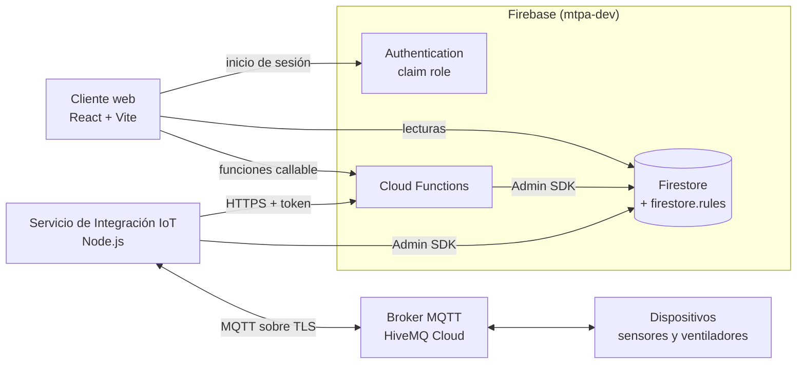

# M.T.P.A. - Mejora Técnica de Producción Avícola

Sistema web de monitoreo IoT para incubadoras avícolas: registra temperatura y humedad, genera alertas cuando las mediciones salen de los límites configurados y permite controlar los ventiladores de forma manual y automática. Los usuarios operan con tres roles: administrador, operador y consulta.

## Estado y alcance

Fecha de redacción: 2026-10-31. Período oficial del proyecto: 01/08/2026 al 31/10/2026.

- **Alcance del período:** autenticación y usuarios, incubadoras y dispositivos, Servicio de Integración IoT, monitorización y alertas, control de ventiladores y automatización.
- **Fase posterior (no comprometida):** históricos, estadísticas y exportación; auditoría; configuración del sistema. El idioma (español/inglés) está diferido: la interfaz es solo en español.
- **Servicio de Integración IoT:** hoy se ejecuta como un proceso Node.js propio (`npm start`). Su despliegue en Cloud Run es una fase posterior.
- **Correo de alertas:** `notificarAlerta` escribe en la colección `mail`, pero el envío depende de la extensión Trigger Email de Firebase, que no está instalada en `mtpa-dev`. Las alertas se ven en la aplicación; no se envía correo (ver [`docs/notificaciones.md`](docs/notificaciones.md)).

La fuente de verdad del alcance, los requisitos y el diseño son los documentos de [`docs/`](docs/) (ERS, DDS y Plan de Trabajo). Si este resumen difiere de ellos, prevalecen esos documentos.

## Arquitectura



El cliente web nunca se comunica con el broker MQTT. Toda escritura sensible (usuarios, incubadoras, dispositivos, comandos de ventilador, reglas de automatización) pasa por una Cloud Function que valida el rol del usuario, que viaja como custom claim `role` (`administrador`, `operador` o `consulta`). Las mediciones llegan por MQTT al Servicio de Integración, que las reenvía a la función HTTPS `procesarMedicion`; esta evalúa los límites, crea o resuelve alertas y dispara la automatización. Los comandos hacia los ventiladores salen del Servicio de Integración a partir de órdenes validadas por una Cloud Function. Detalle en [`docs/arquitectura.md`](docs/arquitectura.md).

Cloud Functions desplegadas (`functions/index.js`): `gestionarUsuario`, `gestionarIncubadora`, `crearDispositivo`, `procesarMedicion` (HTTPS), `notificarAlerta` (trigger de Firestore), `enviarComandoVentilador` y `guardarReglaAutomatizacion`.

## Estructura del repositorio

```text
.
├── frontend/                  Cliente web (React + Vite)
├── functions/                 Cloud Functions (Node.js 20) y scripts de apoyo en scripts/
├── iot-integration-service/   Servicio de Integración IoT (MQTT <-> Firebase) y simulador de dispositivo
├── tools/qa-local/            Kit de pruebas locales con emuladores de Firebase
├── docs/                      Documentación técnica, planes de prueba y documentos del proyecto
├── firebase.json              Configuración de despliegue (reglas, índices y funciones)
├── firebase.emulators.json    Configuración de los emuladores (solo para el kit de QA local)
├── firestore.rules            Reglas de seguridad de Firestore
├── firestore.indexes.json     Índices compuestos de Firestore
└── .firebaserc                Proyecto de Firebase por defecto: mtpa-dev
```

## Requisitos previos

- **Node.js 20.19 o superior.** Las Cloud Functions se ejecutan en Node.js 20 (`engines` de `functions/package.json`), el Servicio de Integración exige `>=20` y Vite 8 requiere `^20.19.0` o `>=22.12.0`. El kit de QA local se probó con Node 24.13.1.
- **npm**, incluido con Node.js.
- **Firebase CLI** (`firebase-tools`) para emuladores y despliegue. El kit de QA local se probó con la versión 15.28.2.
- **JDK**, necesario para el emulador de Firestore (solo para el kit de QA local).
- **bash** (en Windows, Git Bash) y **openssl** para el kit de QA local y los comandos de la guía de demostración.
- Para trabajar contra `mtpa-dev`: acceso al proyecto de Firebase, una cuenta de servicio con permisos sobre el proyecto y las credenciales del broker HiveMQ Cloud (ver [`docs/broker-mqtt.md`](docs/broker-mqtt.md)).

## Configuración

Los archivos `.env` y las claves de cuentas de servicio **nunca se versionan** (están en los `.gitignore` de cada paquete). Solo se documentan los nombres de las variables; los valores se solicitan al equipo por un canal seguro.

| Paquete | Archivo | Variables |
| ------- | ------- | --------- |
| `frontend/` | `frontend/.env` (no existe plantilla versionada) | `VITE_FIREBASE_API_KEY`, `VITE_FIREBASE_AUTH_DOMAIN`, `VITE_FIREBASE_PROJECT_ID`, `VITE_FIREBASE_STORAGE_BUCKET`, `VITE_FIREBASE_MESSAGING_SENDER_ID`, `VITE_FIREBASE_APP_ID` |
| `iot-integration-service/` | `iot-integration-service/.env`, copiado de `.env.example` | Sin ellas el servicio no arranca: `MQTT_HOST`, `MQTT_USERNAME`, `MQTT_PASSWORD`. Necesarias para el flujo completo: `PROCESAR_MEDICION_URL` y `PROCESAR_MEDICION_TOKEN` (reenvío de mediciones), `GOOGLE_APPLICATION_CREDENTIALS` (acceso a Firestore con Admin SDK). Con valor por defecto: `MQTT_PORT` (8883), `MQTT_TOPIC_PREFIX` (`mtpa-dev`). Opcionales: `PROCESAR_MEDICION_MAX_REINTENTOS`, `PROCESAR_MEDICION_BACKOFF_MS`, `ORDEN_MAX_ANTIGUEDAD_SEGUNDOS`, `ORDEN_CONFIRMACION_TIMEOUT_SEGUNDOS`, `LATIDO_TIMEOUT_SEGUNDOS`, `LATIDO_REVISION_SEGUNDOS`, `LATIDO_REFRESCO_SEGUNDOS`, `LATIDO_ESTABILIDAD_SEGUNDOS` |
| `functions/` | `functions/.env` | `INTEGRATION_SERVICE_TOKEN` (mismo valor que `PROCESAR_MEDICION_TOKEN` del Servicio de Integración) |

Variables de otros componentes:

- **Simulador** (`iot-integration-service/`): usa el mismo `.env` y admite `SIMULADOR_INCUBADORA_ID`, `SIMULADOR_SENSOR_ID` y `SIMULADOR_VENTILADOR_ID`.
- **Scripts de `functions/scripts/`:** `GOOGLE_APPLICATION_CREDENTIALS` (ruta a la clave de la cuenta de servicio, guardada fuera del repositorio), `ADMIN_EMAIL`, `ADMIN_PASSWORD` y `ADMIN_NOMBRE` (primer administrador); `PROCESAR_MEDICION_TOKEN` y `VITE_FIREBASE_API_KEY` (datos y escenarios de demostración).

## Ejecución local

Hay dos formas de trabajar. Elija una según el objetivo.

### Opción A: kit de QA local con emuladores (sin tocar servicios reales)

Levanta emuladores de Auth, Firestore y Functions con las reglas, índices y funciones del repositorio, un broker MQTT local, el Servicio de Integración y el simulador, bajo el proyecto `demo-mtpa`. No usa `mtpa-dev` ni HiveMQ Cloud. Todos los comandos son bash y se ejecutan desde la raíz del repositorio. En cada terminal nueva se ejecuta primero `source tools/qa-local/entorno.sh`, que define las variables y corre la verificación de seguridad.

```bash
# Una sola vez
npm install --no-package-lock --prefix functions
npm install --no-package-lock --prefix iot-integration-service

# Terminal 1: emuladores (siempre con --project demo-mtpa)
source tools/qa-local/entorno.sh
(cd tools/qa-local && firebase emulators:start --config ../../firebase.emulators.json --project demo-mtpa)

# Terminal 2: sembrar usuarios y datos base
source tools/qa-local/entorno.sh
node tools/qa-local/seed.js

# Terminal 3: broker MQTT local (receta en el README del kit)

# Terminal 4: Servicio de Integración (después del broker)
source tools/qa-local/entorno.sh
cd iot-integration-service && npm start

# Terminal 5: simulador (con los export SIMULADOR_* que imprime el seed)
source tools/qa-local/entorno.sh
cd iot-integration-service && npm run simulator
```

Antes de arrancar el servicio conviene confirmar que no exista un `iot-integration-service/.env` con credenciales reales: el servicio y el simulador lo cargan y completan las variables que faltan. El broker MQTT local, la comprobación de punta a punta y la conexión opcional del frontend a los emuladores están descritos en [`tools/qa-local/README.md`](tools/qa-local/README.md). Por qué se diseñó así el entorno: [`docs/pruebas/ejecucion-local-emuladores.md`](docs/pruebas/ejecucion-local-emuladores.md). El frontend no se conecta a los emuladores sin un cambio local en `frontend/src/services/firebase.js` que no debe versionarse.

### Opción B: contra el proyecto `mtpa-dev`

Requiere `frontend/.env` y `iot-integration-service/.env` completos (ver Configuración). Estos procesos operan sobre datos y servicios reales.

```bash
# Frontend
cd frontend
npm ci
npm run dev

# Servicio de Integración IoT (otra terminal)
cd iot-integration-service
npm install
npm start

# Simulador de dispositivo (otra terminal)
cd iot-integration-service
npm run simulator
```

Para que las mediciones del simulador se acepten, `SIMULADOR_INCUBADORA_ID`, `SIMULADOR_SENSOR_ID` y `SIMULADOR_VENTILADOR_ID` deben corresponder a documentos existentes en Firestore; los valores por defecto del simulador no existen en la base. Más contexto en [`docs/demo-avances.md`](docs/demo-avances.md).

### Primer administrador

La aplicación no puede crear al primer administrador de un proyecto de Firebase, porque `gestionarUsuario` exige que quien la invoca ya sea administrador. Se crea con un script que se ejecuta una vez por entorno:

```bash
cd functions
npm install
GOOGLE_APPLICATION_CREDENTIALS="<ruta a la clave de la cuenta de servicio>" \
ADMIN_EMAIL="<correo>" ADMIN_PASSWORD="<contraseña>" ADMIN_NOMBRE="<nombre>" \
node scripts/crear-primer-admin.js
```

Procedimiento completo en [`docs/bootstrap-admin.md`](docs/bootstrap-admin.md).

### Datos y escenarios de demostración

`functions/scripts/cargar-datos-demo.js` y `functions/scripts/escenario-demo.js` preparan datos y escenarios en vivo. Ambos son un simulacro por defecto: solo escriben con `--confirmar` y exigen `--proyecto`. Ayuda y flujo completo:

```bash
node functions/scripts/cargar-datos-demo.js --help
```

Guía: [`docs/demo-avances.md`](docs/demo-avances.md).

## Pruebas

Los paquetes no tienen suites de pruebas automatizadas: ningún `package.json` define un script `test`. La verificación se apoya en lo siguiente:

- **Frontend:** `npm run lint` y `npm run build` dentro de `frontend/`.
- **Pruebas manuales documentadas:** los planes de [`docs/pruebas/`](docs/pruebas/) (autenticación, incubadoras, monitoreo y alertas, control de ventiladores, automatización y simulador) describen los casos y los resultados registrados.
- **Kit de QA local** ([`tools/qa-local/`](tools/qa-local/README.md)): permite repetir los planes contra emuladores. No valida Firebase real, HiveMQ Cloud ni hardware, no exige índices compuestos y no reproduce la atomicidad real de Firestore; esos puntos se prueban en `mtpa-dev`.

## Despliegue

El proyecto por defecto de `.firebaserc` es `mtpa-dev`. Antes de desplegar se confirma el proyecto destino. Desde la raíz del repositorio:

```bash
firebase deploy --only firestore --project mtpa-dev   # reglas e índices
firebase deploy --only functions --project mtpa-dev   # Cloud Functions
```

Avisos relevantes:

- `INTEGRATION_SERVICE_TOKEN` debe estar definido en el entorno de las funciones al desplegar (por ejemplo, en `functions/.env`); sin él, `procesarMedicion` rechaza todas las peticiones.
- La carpeta `functions/scripts/` no se despliega (`firebase.json` la excluye).
- Los ventiladores dados de alta antes de que `crearDispositivo` creara su documento requieren una migración única por entorno, **después** de desplegar las funciones: `functions/scripts/crear-documentos-ventiladores.js` con `--dry-run` y luego `--confirmar` (ver [`docs/modelo-datos.md`](docs/modelo-datos.md)).
- `firebase.json` no define Hosting: este repositorio no documenta el despliegue del frontend ni el del Servicio de Integración.
- Desde el entorno del kit de QA local nunca se ejecuta `firebase deploy`.

## Documentación

| Documento | Contenido |
| --------- | --------- |
| [`docs/MTPA_ERS_v1.3.docx`](docs/MTPA_ERS_v1.3.docx) | Especificación de requisitos de software (ERS) |
| [`docs/MTPA_DDS_v1.1.docx`](docs/MTPA_DDS_v1.1.docx) | Documento de diseño de software (DDS) |
| [`docs/MTPA_Plan_de_Trabajo_v1.1.docx`](docs/MTPA_Plan_de_Trabajo_v1.1.docx) | Plan de Trabajo |
| [`docs/arquitectura.md`](docs/arquitectura.md) | Arquitectura, capas del cliente, roles y principio central |
| [`docs/modelo-datos.md`](docs/modelo-datos.md) | Colecciones de Firestore |
| [`docs/contrato-mqtt.md`](docs/contrato-mqtt.md) | Tópicos y mensajes MQTT |
| [`docs/broker-mqtt.md`](docs/broker-mqtt.md) | Broker de referencia y gestión de credenciales |
| [`docs/bootstrap-admin.md`](docs/bootstrap-admin.md) | Creación del primer administrador |
| [`docs/notificaciones.md`](docs/notificaciones.md) | Notificaciones de alertas por correo |
| [`docs/demo-avances.md`](docs/demo-avances.md) | Guion y preparación de la demostración de avances |
| [`docs/pruebas/`](docs/pruebas/) | Planes de prueba y ejecución local con emuladores |
| [`tools/qa-local/README.md`](tools/qa-local/README.md) | Kit de pruebas locales |

## Contribución

- Cada tarea se trabaja en una rama propia (`feat/...`, `fix/...`, `docs/...`, `chore/...`).
- Los cambios se integran a `main` mediante Pull Request con al menos una revisión de otro integrante del equipo.
- Los mensajes de commit siguen [Conventional Commits](https://www.conventionalcommits.org/es/v1.0.0/) (por ejemplo, `feat(alertas): ...`, `fix(demo): ...`, `docs: ...`).
- El seguimiento de tareas se lleva en un tablero Kanban en Notion.
- No se versionan archivos `.env`, claves de cuentas de servicio ni credenciales del broker.
